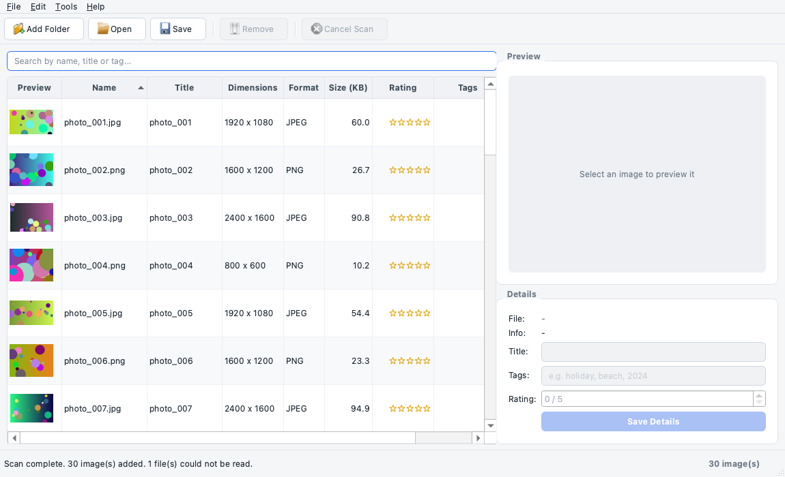
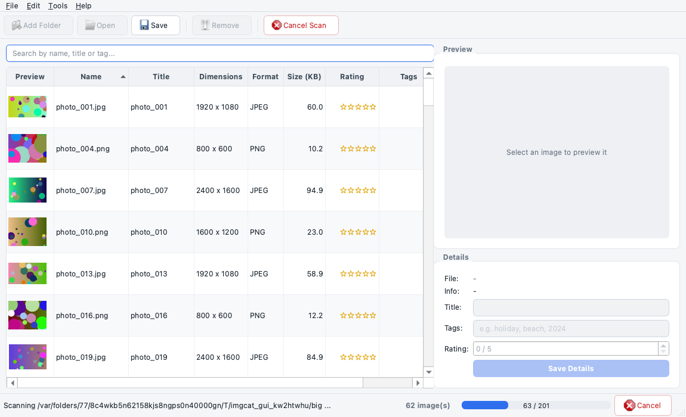
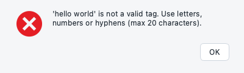
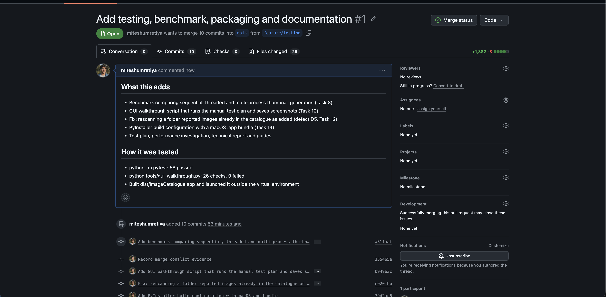
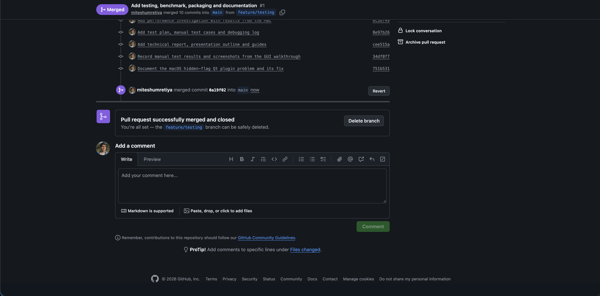
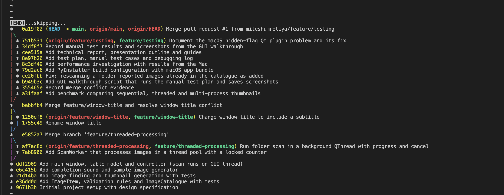

# Technical Report: Image Catalogue

## 15.1 System overview

Image Catalogue is a desktop application for organising a personal photo collection. The user adds a folder and the app scans it in the background, creating a thumbnail and reading the size, format and file size of every image. The images appear in a sortable table with a large preview of the selected image. The user can give each image a title, tags and a 0-5 star rating, search by name, title or tag, and save everything to a catalogue file to reopen later. A short sound plays when a scan finishes.

The app is written in Python 3 with PyQt6 for the GUI, Pillow for image processing and QtMultimedia for sound. It was developed and tested on macOS 26.6 with Python 3.14.7, and the same code runs on Windows and Linux.

## 15.2 Architecture

The project uses MVC, adapted to Qt's model/view framework (see the diagram in `01_design_specification.md`).

| Layer | Module / class | Responsibility |
|-------|----------------|----------------|
| Model | `model/image_item.py`: `ImageItem`, validation functions | One image's data; rules for valid title, tags, rating |
| Model | `model/catalogue.py`: `ImageCatalogue` | The collection: add, remove, edit, search, save/load JSON |
| Model | `model/processing.py` | Find image files; read details and make thumbnails |
| View | `views/main_window.py`: `MainWindow`, `PreviewLabel`, `ImageTable` | Widgets, menus, toolbar, dialogs; emits custom signals |
| View | `views/theme.py` | The light theme: Fusion style, a fixed light palette and one style sheet for buttons, inputs, table and status bar |
| View (Qt adapter) | `views/image_table_model.py`: `ImageTableModel`, `ImageFilterProxy` | Connects the catalogue to `QTableView`; sorting and filtering |
| Controller | `controller/main_controller.py`: `MainController` | Reacts to view signals, updates the model, runs the worker |
| Worker | `workers/scan_worker.py`: `ScanWorker`, `ScanStats` | Background scanning and thread-safe progress counting |

**Key decisions:**
- **The model has no Qt imports.** This means all 68 automated tests run without opening a single window. It also means the same `process_image` function is used by the app, the tests and the benchmark.
- **The view only emits signals.** For example, the Save Details button doesn't validate anything. It emits `details_submitted(title, tags, rating)`, and the controller asks the model to validate and save it. That's why there is no business logic in GUI event handlers (Task 3).
- **Why a Qt table model as well as ImageCatalogue?** `QTableView` needs a `QAbstractTableModel` to tell it when rows are added or removed. Rather than put my data inside a Qt class, I kept `ImageCatalogue` as plain Python and wrote a thin adapter. The alternative of storing data directly in a `QStandardItemModel` would have been less code, but it would mix data with Qt and make testing harder.
- **Custom signals used:** `MainWindow` has 9 (e.g. `open_folder_requested`, `search_changed(str)`, `details_submitted(str, str, int)`). `ScanWorker` has 4 (`progress(int, int)`, `item_ready(object)`, `scan_finished(int, list, bool)`, `scan_failed(str)`).
- **Error handling:** invalid input raises `ValidationError` and the controller shows a message. File problems raise `CatalogueError` with a readable message. A broken image is recorded and skipped without stopping the scan, and the user sees a list of skipped files at the end.

## 15.3 GUI design decisions

- **QMainWindow** gives the standard menu bar, toolbar and status bar layout that users already know.
- **Light theme with clear buttons (`views/theme.py`).** In the first version the toolbar actions showed as plain text, which didn't look like buttons. I switched to Qt's Fusion style with a fixed light palette, so the app looks the same on macOS and Windows and stays light even when the Mac is in dark mode. Every toolbar button now has an icon and text, a border and a hover highlight. The icons are Qt's built-in standard icons, so there are no extra image files to package.
- **Colour means something.** Blue is only used for the main action in the form (Save Details). Red is only used for actions that remove or stop something (Remove, Cancel Scan). Disabled buttons turn grey, so it's clear what you can do at any moment. For example, Remove stays grey until an image is selected.
- **Gold stars** (★★★★☆) make ratings easy to read at a glance. The empty table shows "No images yet. Click Add Folder to start." instead of a blank area, or "No images match your search." when a search finds nothing.
- **All the styling is in one file.** The window code only gives widgets names like `primaryButton` or `dangerButton`, and `theme.py` decides what those look like. The look can change without touching the window's logic.
- **QTableView rather than a QListWidget of thumbnails:** the user wants to compare details (size, rating, tags) and sort by them, and a table does that well. The thumbnail is in the first column so it's still visual.
- **QSplitter** between the table and the preview so the user can choose how much space each gets.
- **QFormLayout** for the details, since label/field pairs are what forms are for.
- **QSpinBox for rating (0-5) and `setMaxLength(100)` on the title:** these stop invalid values before they happen. The model validates anyway, in case data comes from somewhere else such as a hand-edited file.
- **Progress bar and Cancel button in the status bar,** only visible while scanning, so they don't clutter the window the rest of the time. Add Folder and Open Catalogue are disabled during a scan so the user can't start two at once.
- **Confirmation dialogs** only for actions that lose something (remove, closing with unsaved changes). Information that doesn't need a decision goes in the status bar instead of a popup.
- **Keyboard shortcuts** (Ctrl+O, Ctrl+S, Delete, Esc) for faster use.
- **Sound (QtMultimedia, `QSoundEffect`):** a scan of a large folder can take a while, so the user may switch to another window. The chime tells them it's finished without having to keep checking. It can be turned off in the Tools menu. I generated the sound myself (`tools/make_sound.py`), so there are no copyright issues.

## 15.4 Concurrency design

**The problem.** Making a thumbnail means decoding a full-size photo. In the benchmark, 40 large photos took 2.1 seconds one after another, so a real folder of a few hundred photos takes many seconds. My first version (commit "Add main window, table model and controller (scan runs on GUI thread)") did this in a simple loop inside the controller. While it ran, the window couldn't redraw or respond to clicks, and macOS showed the spinning wheel. That is why the scan was moved to a background thread on the `feature/threaded-processing` branch.

**The technique.**
1. The controller creates a `QThread` and moves a `ScanWorker` (a `QObject`) onto it with `moveToThread`. The worker's `run()` slot starts when the thread starts.
2. Inside `run()`, a `ThreadPoolExecutor` with 4 threads processes several images at the same time.
3. As each image finishes, the worker emits `item_ready(item)` and `progress(done, total)`.
4. When it finishes it emits `scan_finished(...)` and the thread quits. A short sound plays and any skipped files are reported.

**Getting results safely to the GUI.** Qt widgets must only be touched from the GUI thread. Because the worker lives in a different thread from the controller, Qt automatically uses **queued connections**. The signal's arguments are put in the GUI thread's event queue and the slot runs on the GUI thread. The worker never touches a widget or the catalogue directly.

**Synchronisation and thread safety (Task 7).**

| Shared resource | Who uses it | What could go wrong | Protection |
|-----------------|-------------|---------------------|------------|
| `ScanStats` counters (processed count, failure list) | All 4 pool threads write; the worker thread reads | `processed += 1` is really read, add, write. Two threads can read the same value and both write back value+1, so one update is lost. The progress bar would never reach 100%. | `threading.Lock` around every read and write (`with self._lock:`) |
| The catalogue and the table model | Only the GUI thread | If a worker thread added rows while the table was repainting, Qt could crash or show wrong rows | **Controlled ownership:** only the GUI thread touches them; workers send items by signal |
| Cancel flag | GUI thread sets it; pool threads read it | A plain variable could be read in an inconsistent state | `threading.Event`, which is designed to be shared between threads |

Evidence: `tools/race_demo.py` runs 4 threads x 10,000 increments. **Without a lock it gave 10,006 instead of 40,000. With the lock it gave exactly 40,000.** The automated test `test_stats_counter_is_correct_with_many_threads` checks the real `ScanStats` with 8 threads.

**Cancelling.** `cancel()` is called directly from the GUI thread, not through a signal. A queued signal to the worker would sit in the worker thread's queue until `run()` finished, which is too late. The event is safe to set from any thread. When it is set, images not yet started are cancelled and those in progress are allowed to finish, so no half-written thumbnails are left behind.

**Responsiveness evidence.** During manual test MT04, a 20 ms timer on the GUI thread kept firing for the whole 200-image scan (see `evidence/gui_walkthrough_results.txt`). If the GUI thread had been blocked, the timer couldn't have fired.

**Performance.** See `03_performance_investigation.md`. On my 8-core Mac, 4 threads gave a 3.25x speed-up and 8 threads gave 4.5x. That was faster than processes (2.69x with 4), because Pillow releases the GIL and threads avoid the cost of pickling. I chose threads because they were faster here and are simpler with Qt signals and packaging.

## 15.5 Testing

See `02_test_plan.md`: 27 manual tests, 68 automated tests (all passing), and a debugging log of 5 defects found and fixed.

- **Automated:** `python -m pytest -v` gives 68 passed in under a second. The tests cover validation (normal, boundary and invalid values), the catalogue, file handling, thumbnails, the worker and the locked counter (8 threads x 5,000 updates).
- **Manual:** the 27 GUI tests were run on the real window with `tools/gui_walkthrough.py`, which saves a screenshot for each important step to `docs/evidence/`. Sound, keyboard shortcuts and the packaged app were checked by hand.
- **Defects:** the most interesting one was D5. Rescanning a folder reported "30 image(s) added" when nothing was new. The worker can't know which images are duplicates, because that check happens on the GUI thread. The fix was to count additions in the controller. It is a separate "Fix:" commit in the Git history.

## 15.6 Source-control workflow

The project was built up in stages, with a commit at each step:

1. **main**: project setup and design spec, then the model (ImageItem, validation, ImageCatalogue) with tests, then image processing with tests, then the sound and sample-image tools.
2. **main**: the first GUI, with the scan running on the GUI thread (it froze the window).
3. **`feature/threaded-processing`** branch: added `ScanWorker` with the thread pool and the locked counter, then switched the controller to a background `QThread` with progress and cancel. Merged back into main with `--no-ff`, so the branch is visible in the history.
4. **`feature/window-title`** branch: a **controlled merge conflict**. Both main and the branch changed the same `setWindowTitle(...)` line. `git merge` stopped with `CONFLICT (content): Merge conflict in catalogue/views/main_window.py` and added `<<<<<<< HEAD`, `=======` and `>>>>>>>` markers. `HEAD` is main's version and the part after `=======` is the branch's. I resolved it by keeping the branch's title ("Image Catalogue - Photo Organiser"), deleted the markers, ran the tests (68 passed) and committed the merge. The full output is in `evidence/git_merge_conflict.txt`.
5. **`feature/testing`** branch: the benchmark, the GUI walkthrough script, the D5 bug fix as its own `Fix:` commit, the PyInstaller configuration (with the macOS `.app` bundle), and the test, performance and report documents.
6. **Pull request and merge:** `feature/testing` was merged into main on GitHub through pull request #1, then the GitHub screenshots were added on main.
7. **`feature/ui-polish`** branch: the visual polish (light theme, button icons and colours, gold stars, empty-table message), with the tests and the GUI walkthrough re-run so the screenshots show the new look. Merged into main through pull request #2.

**Remote:** all four branches were pushed to a private GitHub repository (`miteshumretiya/image-catalogue`) with `git push -u origin ...`. Pull request #1, "Add testing, benchmark, packaging and documentation", contained 10 commits and 25 changed files, with a description of what it adds and how it was tested. After checking the "Files changed" tab I merged it on GitHub, then ran `git pull` to bring the merge commit back to my Mac. I kept the feature branches on GitHub instead of deleting them, so the history stays visible.

`git log --oneline --graph --all` shows the three branches splitting off and merging back in, including the conflict merge and the pull request merge:

## 15.7 Evaluation

**Strengths**
- Clear separation of concerns, which made testing easy: 68 automated tests run in under a second.
- The GUI stays responsive during long scans, with progress, cancel and a completion sound.
- Robust error handling: broken images, corrupt catalogue files and invalid input all give clear messages instead of crashes.
- Small and readable. Each file has one job.

**Limitations**
- If you move or rename your photos, the catalogue still points to the old paths. There is no "relink" feature.
- Thumbnails are cached in the home folder and never cleaned up.
- The preview loads the full image on the GUI thread. With very large photos (e.g. 50 MP) selection can feel slightly slow.
- Only one folder can be scanned at a time.
- There are no automated GUI tests. GUI behaviour was checked manually.

**Technical problems I hit**
- **Cancelling.** My first idea was to send a "cancel" signal to the worker. But the worker's thread is busy inside `run()`, so a queued signal would only be delivered after the scan had already finished. The fix was a `threading.Event` that the GUI thread sets directly and the pool threads check before each image.
- **Counting what was "added".** The status message counted every image the worker read, so rescanning a folder claimed images were added when they weren't (D5). The worker can't see the catalogue, by design, so the count had to move to the controller.
- **The GIL result surprised me.** I expected threads to be useless for CPU work in Python, but they were the fastest option. That's because Pillow releases the GIL. I had to change the benchmark (D4) to show the GIL's real effect on pure-Python code.
- **The app wouldn't start on my Mac at first.** It stopped with `Could not find the Qt platform plugin "cocoa"`, even though the plugin file was there. Using `QDir` in Python, I found that Qt could only see the file when hidden files were included. `ls -lO` showed macOS had set the `hidden` flag on every file inside `.venv`, and Qt ignores hidden plugins. Running `chflags -R nohidden .venv` fixed it. The built `.app` was not affected because it lives in `dist/`. I added this to the README's troubleshooting section.
- **Packaging on macOS.** PyInstaller first produced a folder with a plain program file, not a normal Mac app. Adding a `BUNDLE` step to the spec file produced `ImageCatalogue.app`.

**Possible improvements**
- Load the preview in the background too, or use a medium-sized cached preview.
- Add rows to the table in batches (e.g. every 20 images) to reduce GUI work. This also reduces the sequential part in Amdahl's Law terms.
- Store the catalogue in SQLite instead of JSON for large collections.
- Add pytest-qt tests for the main window.
- Read EXIF data (date taken, camera) and allow sorting by date.

**Alternative approaches**
- `QThreadPool` + `QRunnable` instead of `QThread` + `ThreadPoolExecutor`. It is more "Qt", but QRunnable can't emit signals directly, so it needs an extra helper QObject.
- `ProcessPoolExecutor` for true parallelism. It is only worth it for pure-Python CPU work, and it adds pickling overhead and packaging complexity.
- `asyncio` (e.g. with qasync). It is good for I/O-bound work like downloads but doesn't help CPU-bound image decoding.

## References

- Riverbank Computing (2025) *PyQt6 Reference Guide*. Available at: https://www.riverbankcomputing.com/static/Docs/PyQt6/
- The Qt Company (2025) *Threads and QObjects*. Available at: https://doc.qt.io/qt-6/threads-qobject.html
- The Qt Company (2025) *Model/View Programming*. Available at: https://doc.qt.io/qt-6/model-view-programming.html
- Python Software Foundation (2025) *concurrent.futures: Launching parallel tasks*. Available at: https://docs.python.org/3/library/concurrent.futures.html
- Python Software Foundation (2025) *threading: Thread-based parallelism*. Available at: https://docs.python.org/3/library/threading.html
- Pillow contributors (2025) *Pillow documentation*. Available at: https://pillow.readthedocs.io/
- PyInstaller Development Team (2025) *PyInstaller Manual*. Available at: https://pyinstaller.org/en/stable/
- Amdahl, G. M. (1967) 'Validity of the single processor approach to achieving large scale computing capabilities', *AFIPS Conference Proceedings*, 30, pp. 483-485.
- Microsoft (2024) *Introduction to PLINQ*. Available at: https://learn.microsoft.com/en-us/dotnet/standard/parallel-programming/introduction-to-plinq

All online sources accessed 30 October 2026.
